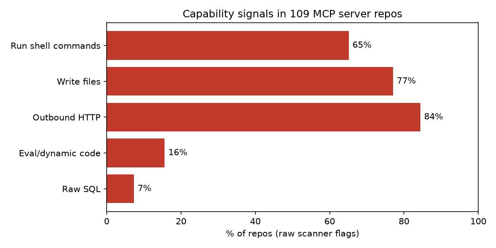
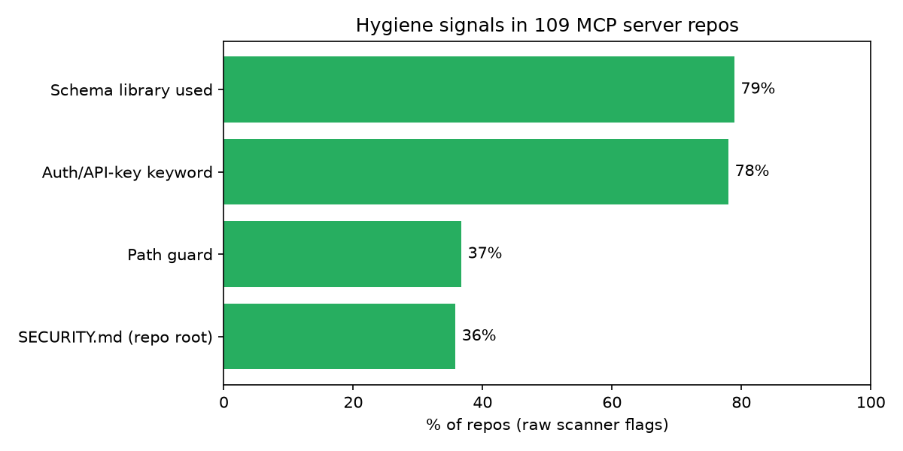
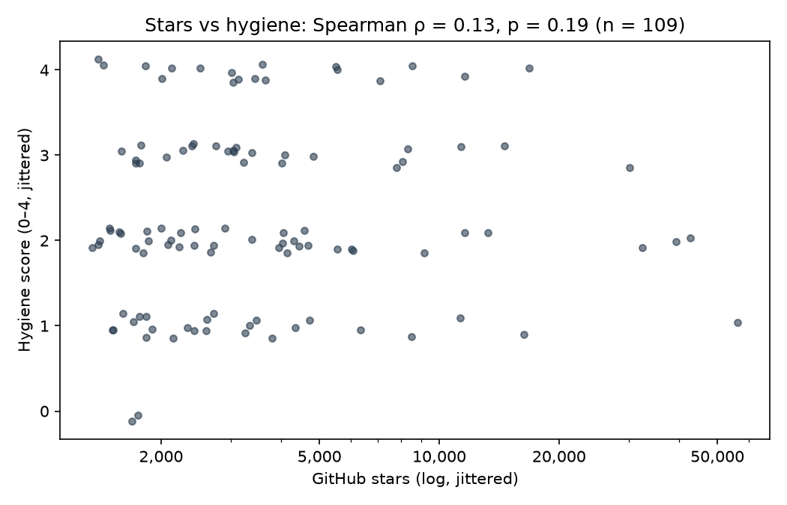
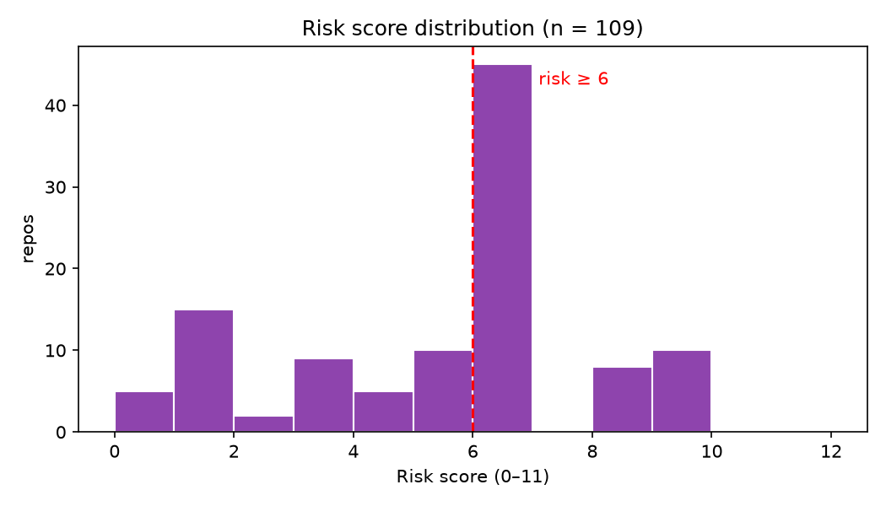

# MCP Risk Census

[](https://github.com/aidankaras/mcp-risk-census/actions/workflows/git-signoff.yml)

A static census of **109 public GitHub repos that a keyword filter classed as Model Context
Protocol (MCP) servers**: what they let an AI agent do on your machine, and what hygiene protects
you. Includes an LLM-labeled spot-check of the scanner on 20 of the repos, because a census you
haven't validated is just pattern matching.

Built by Aidan Karas — Data Science & Mathematics undergraduate, Boston University.

## Headline findings

- **MCP servers are powerful by default.** Raw scanner flags: 65% can run shell commands, 77% write
  files, 84% make outbound network calls. Adjusted for the scanner's measured precision and recall
  (raw × precision ÷ recall, 95% bootstrap interval over the 20 labeled repos): ~49% (33–65%),
  ~59% (39–77%), ~74% (55–96%).
- **Protections lag capabilities.** 79% use a schema library such as zod or pydantic, but only 37%
  show a path guard (checks that restrict which filesystem paths they touch) and 36% have a
  SECURITY.md in the repo root. See [What the signals measure](#what-the-signals-measure) for why
  the first number mostly reflects SDK usage.
- **No evidence that popularity predicts hygiene.** Spearman correlation between GitHub stars and
  hygiene score: ρ = 0.13, p = 0.19 (weak, not significant; mean hygiene 2.45 above vs 2.13 below
  median stars). Stars vs risk: ρ = 0.08, p = 0.41.
- **Regex-only secret scanning produced only false positives here.** Among all 250 candidate repos
  (not just the 109), 17 matched a key-shaped pattern; 1 of those 17 is in the census. The matches
  are 108 strings on 104 lines in the files the scanner reads, 97 of those lines in files whose path
  contains `test`, `fixture` or `spec`. Manual review of every line found no live credential.
  Per-line verdicts were not recorded, so this rests on that review.
- 59 repos expose a remote (HTTP/SSE) transport; 9 of them show no auth signal. The auth heuristic
  is the crudest in this study (see below), so treat that as "worth checking," not a finding.
- 8 repos combine a risk score ≥ 6 with a hygiene score ≤ 1.

The keyword filter keeps some repos that are not servers. 13 of the 109 describe themselves as a
guide, a skill or asset library, a client, a framework, or a proxy/gateway
(`data/likely_non_servers.json`; picked from descriptions, not a full hand-label). Without them
(n = 96), every rate above moves by at most 3 points and ρ is 0.13 (p = 0.20); see
`excluding_likely_non_servers` in `data/summary.json`.

## Charts






## Method

1. **Collect** (`collect.py`): GitHub search (topics `mcp-server`, `model-context-protocol`, plus
   TS/Python keyword search), deduped, awesome-lists and repos of 150,000 KB or more dropped;
   top 250 by stars. The collection run reported 671 unique repos; that count was printed but not
   saved. `collect.py` now writes it to `data/collect_meta.json`.
2. **Scan** (`scan.py`): shallow clone → regex counts of capability & hygiene signals → delete clone.
3. **Filter & score** (`analyze.py`): keep repos whose name or description mentions MCP and none of
   `sdk`, `framework`, `client`, `awesome`, `list of`, `inspector`, `tutorial`, with 1–59,999 lines
   of code (n = 109). Signals are binary.
   Risk = shell 3 + eval 3 + fs_write 2 + raw SQL 2 + HTTP 1 (0–11).
   Hygiene = SECURITY.md + path guard + input schema + auth signal (0–4).
4. **Key check** (`keycheck.py`): re-clone the repos flagged for a hardcoded key and list every
   matching line with each key-shaped string cut to its first 6 characters, for manual review.
5. **Validate** (`dump_sample.py`, `data/hand_labels.json`, `validate.py`): 20 repos sampled,
   stratified by stars. Capability matches were shown with their code context, up to 25 per signal
   per repo (15 of the 100 repo × signal cells hit that cap), and each repo was labeled as really
   capable or not for each signal. The labels come from one model (Claude Sonnet) run as two
   reviewers on 10 repos each: every repo was labeled once, no agreement was measured, and there
   are no human labels yet.

Per-repo data is in `data/` (see caveats).

### What the signals measure

The data in this repo comes from scanner rubric v1 (`scan.py` at commit `515fada`). Known limits:

- `input_schema` matches `zod`, `inputSchema`, `pydantic` or `BaseModel` anywhere. The MCP SDKs
  expect a schema for every tool, so this mostly shows that a repo uses an SDK, not that it chose
  to validate input.
- `auth_mentioned` matches `oauth`, `bearer`, `Authorization` or `api_key` anywhere. That mostly
  catches a server calling *third-party* APIs with a key, not checking who calls the server. It
  still counts toward hygiene and drives the "remote without auth" number.
- `security_md` checks the repo root only, so it undercounts: GitHub also reads `.github/` and
  `docs/`.
- `CODE_EXT` left out `.tsx/.jsx/.cjs/.mts/.cts/.kt/.swift`, so some TS/JS servers were
  under-scanned.

`scan.py` on the main branch is rubric v2: it fixes the last two items and drops two signals that
were never used (`env_secrets`, the `stdio` count). Those changes take effect at the next full
baseline run. The monthly rescan stays pinned to v1 so its snapshots compare like with like.

### Scanner validation

Run `python3 validate.py` to rebuild `data/validation.json`. Intervals are 95% Wilson intervals.

| Signal | Flagged | Truly capable | Precision (95% CI) | Recall (95% CI) |
|---|---|---|---|---|
| shell_exec | 12 | 9 | 0.75 (0.47–0.91) | 1.00 (0.70–1.00) |
| fs_write | 13 | 10 | 0.77 (0.50–0.92) | 1.00 (0.72–1.00) |
| outbound_http | 16 | 14 | 0.81 (0.57–0.93) | 0.93 (0.69–0.99) |
| eval_dynamic | 3 | 1 | 0.33 (0.06–0.79) | 1.00 (0.21–1.00) |
| sql_raw | 1 | 1 | not validated (n = 1) | not validated (n = 1) |

According to the reviewers, false positives came mostly from build scripts, test tooling, bundled
frontend code and comments. `eval_dynamic` is too noisy to publish without a tighter pattern. The
reviewers found one capability the scanner missed (an HTTP tool in `exa-labs/exa-mcp-server`),
which is why outbound_http recall is 0.93. The sql_raw row validates nothing: its one flagged repo
(`bytebase/dbhub`) was flagged by a match that spans lines, and the label dump then matched line by
line, so the reviewer never saw it. `dump_sample.py` now matches the same way as `scan.py`.

## Reproduce

```bash
python3 -m pip install -r requirements-dev.txt   # pinned matplotlib, scipy, pytest, ruff
# collect.py needs the GitHub CLI (`gh`, authenticated); set GH_BIN if it is not on PATH
python3 collect.py && python3 scan.py              # new data; scan.py is rubric v2 (see above)
python3 analyze.py && python3 validate.py && python3 charts.py   # offline, from the committed data
```

`analyze.py`, `validate.py` and `charts.py` reproduce the committed `data/` and `charts/` from
`data/scan.jsonl`; CI checks the data part on every push. `scan.py` is resumable (failed clones are
retried on the next run) and clones are deleted after scanning; nothing is executed in scanned
repos.

## Caveats

- Static pattern matching only; "can run shell" ≠ vulnerable. This is **not** a security audit of
  any project, and nothing here alleges a specific project is unsafe.
- Percentages are raw scanner output unless marked as validation-adjusted.
- The write-up does not single out repos, but the data files do name them:
  `data/servers.jsonl` has every census repo's signal counts and risk/hygiene scores,
  `data/hand_labels.json` names the 20 labeled repos, and `data/keyhits.jsonl` lists the file and
  line of each key-shaped match (with the string redacted). These are heuristic regex counts, not
  judgments of any project; several high-scoring repos are tools whose risky capability is their
  advertised purpose (e.g. security/automation tooling). None of the key matches was a live
  credential. If a future run finds one, it should be reported privately to the maintainer before
  anything is published.
- n = 109 of a much larger ecosystem, top-of-search by stars, and the set includes some
  non-servers (see above); results describe that sample.

## Tests

`python3 -m pytest` covers the signal regexes, the shared file filter and multi-line matching,
key redaction (including two keys on one line), the server filter and scoring, the Spearman
calculation on tied data, the validation intervals, and the snapshot diff. CI runs them, plus
`ruff check`, on every push.
